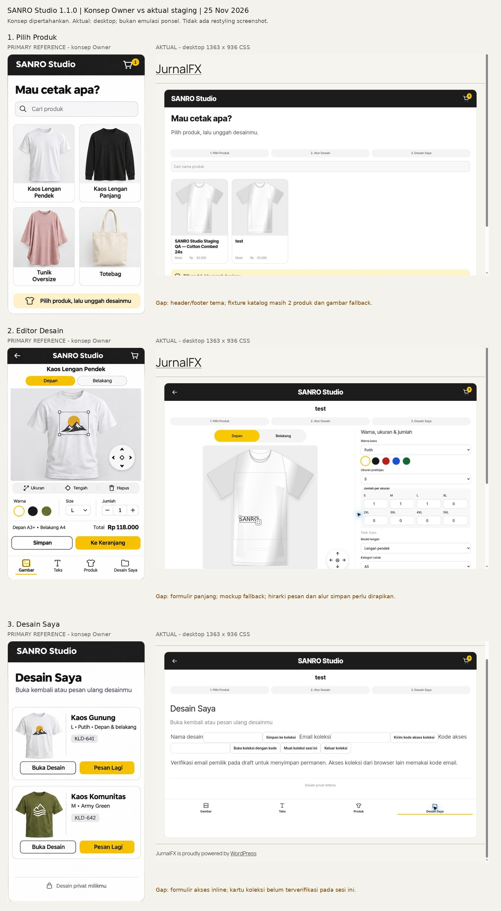
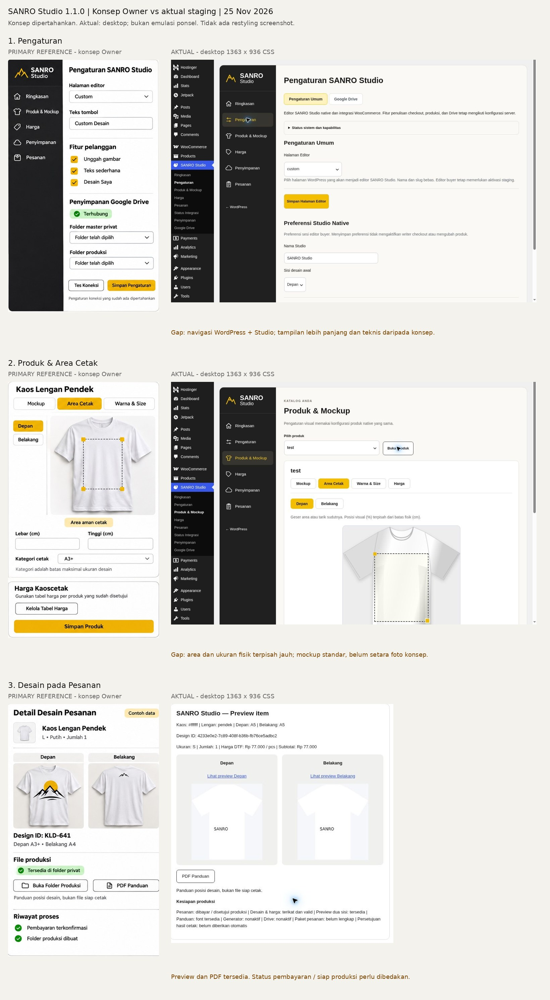

# SANRO Studio1.1.0 — independent live UI/UX review

25 November2026 (Asia/Jakarta). **NO-GO untuk visual acceptance.** Buyer dan admin telah direview langsung di Cloud Browser. Tampilan sudah memiliki identitas SANRO, tetapi belum cukup dekat dengan dua PRIMARY VISUAL REFERENCE Owner. Ini bukan penilaian ulang keberhasilan instalasi/fungsi produksi.

Checkpoint PR52 `0c34acaa51cf00f738ce31cea8e39777fa8f1d43`; source terinstal `12b2c043cc6ccbb3e7c828949bf524ff6f2e84b1`, versi1.1.0. Evidence CLI installed digest/runtime/CSS-JS yang sudah PASS dipertahankan sebagai evidence sebelumnya, tidak diuji ulang. Source, instalasi, konfigurasi, produk dan order existing tidak diubah dalam putaran ini. Hanya satu draft desain review sintetis baru dibuat, prefix46d10141; tidak ada order/checkout/pembayaran baru. Cart existing tetap3 item.

Progres fungsional **96,50% →96,50%; delta0**. Angka indeks UI di bawah bukan persentase development.

## Konsep dibanding aktual

Kiri merupakan konsep mobile Owner, kanan aktual desktop. Ukuran/perangkat memang berbeda; ini membandingkan komposisi, hierarki dan komponen, bukan pixel-diff antarviewport yang sama. Referensi asli disertakan di references/. Screenshot aktual hanya di-crop untuk menghapus toolbar akun/billing dan di-encode ulang tanpa metadata; tidak direstyle, digenerate atau direkayasa. File manifest menjelaskan setiap crop. Capture area sempit yang rusak dibuang. Screenshot viewport dipakai setelah full-page capture timeout dua kali.

## Cakupan dan skor

Desktop:1363×936 CSS. Probe layout sempit:454×312 CSS melalui zoom browser300%, dikembalikan100%. Ini **BUKAN pengujian ponsel, portrait390×844, atau touch**. DevTools ditolak kebijakan organisasi browser; tidak ada API viewport/touch yang didokumentasikan pada sesi ini. Tidak ada bypass. Bukti sempit dinamai narrow-454, bukan mobile. Koleksi terautentikasi tidak tersedia, sehingga kartu populated, Buka Desain, Pesan Lagi, share/revoke tidak diuji. Tidak ada OTP atau email yang dikirim.

Skor merupakan evaluasi heuristik pada bagian yang diamati, bukan survei buyer awam atau pengukuran FPS. Patokan90 mendekati konsep tanpa gap P1;70 sudah dikenali tetapi masih ada gap besar;50 mismatch komposisi/alur yang signifikan. Responsivitas lengkap15% ditahan, dan touch tidak mendapat skor.

| Kriteria | Bobot | Buyer desktop | Administrator desktop |
|---|---:|---:|---:|
| Kesesuaian visual |35%|55|68|
| Interaksi yang diuji pada desktop |25%|78|82|
| Kemudahan penggunaan, penilaian heuristik |20%|52|62|
| Responsivitas ponsel lengkap |15%|NOT TESTED|NOT TESTED|
| Konsistensi desain |5%|65|68|
| Subtotal berbobot yang dapat dinilai |85 poin|52,40/85|60,10/85|
| **Indeks observasi dinormalisasi** |subtotal÷85×100|**62/100**|**71/100**|
| Skor final dengan cakupan100% |100%|**DITAHAN**|**DITAHAN**|

Buyer: warna/header/tab/toolbar sudah dikenali. Skor visual dikurangi karena chrome tema luar, mockup fixture, collection form inline, serta komposisi/pesan yang jauh dari konsep. Interaksi desktop umumnya berhasil, tetapi alur save→upload terpisah dan state alat latar membingungkan. Admin lebih konsisten, tetapi Ringkasan duplikat, dua sidebar, form panjang dan kontrol teknis belum sekompak konsep. Tidak ada skor yang diberikan untuk touch atau kartu koleksi yang belum diuji.

## Hasil interaction acceptance

| Pemeriksaan | Hasil | Evidence/observasi |
|---|---|---|
| Search katalog |PASS|Filter `test`; query tanpa hasil menampilkan pesan yang benar |
| Tambah teks, drag, resize, center dan D-pad |PASS desktop|Teks22→34px; posisi berubah; D-pad menambah1%; center bekerja |
| Sisi depan/belakang |PASS|Teks masing-masing sisi kembali saat tab diganti |
| Upload gambar/master |PASS dengan gap UX|Fixture RGB PNG180×180 putih+lingkaran kuning; metadata draft dan master privat berhasil disimpan terpisah |
| Hapus latar |PASS dengan bug P1|Setelah upload sukses tombol tetap disabled; pindah sisi lalu kembali mengaktifkannya; removal berhasil |
| Drag/resize gambar, center, delete |PASS desktop|Lebar60→69%; D-pad dan center berubah; Hapus lokal menyembunyikan gambar; reload mengembalikan draft tersimpan |
| Warna, preview size, multi-size |PASS|Hitam, previewL, S/M/L masing-masing1; total3pcs |
| Validasi ukuran |PASS, UX kurang|Simpan teks yang terlalu besar untukA5 ditolak dengan pesan umum; pindah kategori kedua sisiA3+ membuat simpan berhasil |
| Simpan/buka ulang |PASS|Draft review46d10141 berhasil dibuka ulang; hanya data sintetis |
| Harga |PASS|Estimasi dan quote resmi samaRp390.000: S127.000+M130.000+L133.000. Rp240.000 sebelumnya adalah konfigurasiA5 kedua sisi; bukan konflik harga |
| Koleksi |PARTIAL|Halaman/access form terlihat; sesi koleksi belum terverifikasi. Jangan mengklaim populated cards/fork/reorder/share PASS |
| Admin navigasi dan tab |PASS desktop|Pengaturan, produk/mockup, varian, harga, storage dan pesanan terbuka |
| Ringkasan |FAIL visual|Dua `.sanro-admin-shell` dan dua judul/isi Ringkasan pada satu halaman |
| Print area |PASS tanpa save|Dragx27→31,5;y22→24,5; resize46×54→49,6×57,2; keyboard arrows; reload kembali ke konfigurasi tersimpan |
| Drive setup |PASS visual disconnected|Field credential/folder kosong; NOT CONFIGURED; eksporOFF. Connect/OAuth/live upload tidak dijalankan |
| Order56 |PASS UI read-only|Tiga panel item Studio; preview depan/belakang tersedia; PDF Panduan native berhasil diunduh |
| File produksi Drive |DEFERRED BY OWNER|Tidak ada tautan folder yang dikarang; akses/upload Drive bukan blocker V1 |
| Horizontal overflow |PASS spot checks|scrollWidth≤innerWidth pada viewport desktop dan beberapa halaman sempit yang diukur. Bukan jaminan ponsel |
| Portrait mobile/touch |NOT TESTED|Batas perangkat browser; tidak diberi skor |

Tidak ada pembayaran nyata, order baru, penambahan cart, perubahan gateway, regenerasiDTF, OAuth Drive, source change, reinstall atau merge. Pengujian save dan background hanya mengubah draft review baru. Perubahan area produk diuji sebagai perubahan form lokal, dibuang lewat reload.

## Gap dan prioritas

Tidak ada P0 yang teramati pada lingkup review ini; ini bukan hasil full audit keamanan/fungsi.

| ID | Prioritas | Gap aktual | Perubahan teknis spesifik untuk executor |
|---|---|---|---|
|V01|P1|Ringkasan admin dirender dua kali|`includes/admin.php`: root menu memakai `sanro_studio_admin_landing`, submenu slug sama memakai `sanro_studio_ui_summary`; keduanya terdaftar pada page hook yang sama. Gunakan satu callback yang sama atau satu registration render; assert live shell count1. Ini penjelasan source atas failure browser, bukan hasil fix.|
|V02|P1|Header JurnalFX, separator dan footer tema tampil di luar buyer Studio|`includes/buyer.php` dan scoped `assets/buyer.css`: cocokkan wrapper tema aktual atau gunakan dedicated Studio view hanya pada route Studio. Pertahankan wp_head/wp_footer, nonce dan enqueue. Jangan mengubah tema/global halaman toko.|
|V03|P1|Desain Saya berupa deret label/input/tombol inline; kosong tanpa keadaan akses yang jelas|`assets/studio-ui.js`, `buyer.css`, `collection.js`: style form terpisah dari `.sanro-controls`, susun grid/stack, primary action tunggal untuk membuka koleksi, pisahkan save-name dan akses email dalam disclosure; tampilkan loading/error/locked/empty secara eksplisit. Pertahankan pemeriksaan owner/token/OTP. Uji populated cards/fork/reorder hanya dengan koleksi sintetis terverifikasi; jangan membuat kartu palsu.|
|V04|P1|Save pada desain bergambar menyimpan metadata teks; upload master masih tombol terpisah|Orkestrasi handler buyer memakai helper native yang sama: simpan draft→upload/bind master→verifikasi→preview/status sukses bila lengkap. Jika belum digabung, beri next-action eksplisit pada pesan sukses dan CTA upload. Jangan mengubah otorisasi, geometry atau quote.|
|V05|P1|Tombol hapus latar tidak aktif langsung setelah upload berhasil|`assets/buyer.js` upload handler: `refreshBackgroundControl()` saat ini dipanggil sebelum `sides[name].file=null`. Pindahkan refresh sesudah cleanup seluruh completed files. Buktikan tombol aktif tanpa toggle sisi pada opaque fixture, tetap nonaktif untuk PNG transparan.|
|V06|P1|Error kategori/area tidak menunjuk langkah perbaikan; validasi utama tersembunyi di advanced|`buyer.js`/workspace: tampilkan validasi dekatcanvas dan save, identifikasi sisi/objek/kategori, arahkan fokus ke alat yang benar. Jangan otomatis menaikkan kategori/harga tanpa tindakan buyer.|
|V07|P1 acceptance|Portrait/touch belum terverifikasi|Sesudah fix, gunakan viewport390×844 dan320px serta touch browser yang didukung/ponsel aktual. Uji drag/resize/scroll/fixed nav serta batas canvas dan qty; jangan menerima probe zoom sebagai bukti touch.|
|V08|P2|Dua sidebar admin; form area dan cm terpisah jauh di bawah fold|Scoped Studio shell dalam `studio-admin.css`: kurangi chrome WordPress hanya pada halaman Studio dengan jalan kembali WordPress; padatkan selector produk dan spacing, dekatkan fisikcm/kategori dengan mockup. Tetap pertahankan semua kontrol.|
|V09|P2|Fixture katalog hanya dua produk, namaQA/test dan fallback putih identik; belum setara foto konsep|Data fixture staging/Media Library: pilih nama dan mockup milik merchant/Owner yang telah disetujui melalui fitur mapping existing. Pisahkan gap data dari bug kode; tidak boleh mengambil aset Lumise atau mengubah production.|
|V10|P2|Typography pesan tidak konsisten; beberapa status panjang sangat besar, lainnya sangat kecil|Atur font/line-height/spacing untuk seluruh status/collection/advanced pada root Studio; ringkas bahasa buyer tanpa jargon token/server/private-writer. Teks teknis tetap tersedia di area admin/advanced yang relevan.|
|V11|P2|Handle resize24px dan D-pad hit targets kecil|Perbesar hit-area aksesibel menjadi sekitar44px tanpa membesarkan ikon berlebihan; keyboard/focus/touch harus tetap bekerja. Ukuran24px diamati pada DOM, bukan hasil uji jari.|
|V12|P2|Status order menggabungkan dibayar/disetujui produksi; raw metadata mendominasi|`order-preview.php`/readiness: bedakan pembayaran Pending payment dari izin siap produksi, labelDrive opsional/deferred, kelompokkan raw metadata/debug. Jangan memberi centang pembayaran seperti contoh konsep untuk order56 yang belum berbayar.|

Buka folder produksi tidak diuji karena live Drive memang deferred; ketiadaan link pada NOT CONFIGURED bukan bug. PDF yang diunduh adalah panduan, bukan DTF siap cetak. Tidak ada klaim bahwa fileDTF baru dihasilkan atau telah diunduh dalam putaran ini.

## Paket satu putaran perbaikan untuk Codex CLI

1. V01+V02+V10: satu render admin, isolasi theme chrome buyer, konsistensi typography.
2. V04+V05+V06: satu alur save/upload yang jelas, refresh alat latar, validasi inline.
3. V03: collection layout, loading/locked/error/empty states; pertahankan collection/share/reorder native.
4. V08+V09+V11+V12: padatkan panel produk/admin, fixture visual yang disetujui, hit targets dan status order yang jujur.
5. Acceptance terfokus: desktop+portrait/touch, populated collection, tidak adaoverflow; periksa ulang hanya UI yang berubah, quote/desain dan save. Tidak perlu fullaudit/DTF/payment/Drive live.

Ini daftar perbaikan, bukan otorisasi worker baru atau perubahan production. Putaran review tidak menjalankan executor lain.

## Tujuh tahap / keputusan

| Tahap | Status putaran review |
|---|---|
|1 Fondasi/core|Evidence sebelumnya dipertahankan; tidak diubah|
|2 Backend/admin|Direview; V01/V08/V12 perlu refinement|
|3 Buyer|Direview; V02/V03/V04/V06 perlu refinement|
|4 Harga|Estimasi dan quoteRp390.000 PASS|
|5 Simpan/ownership/share|Draft save/reopen PASS; koleksi terautentikasi/reorder/share NOT TESTED|
|6 Checkout/produksi/Drive|Order56 preview/PDF PASS; tanpa order/payment/DTF baru; Drive live DEFERRED|
|7 Visual QA/rilis/mobile|NO-GO visual; portrait/touch belum diuji; instalasi1.1.0 tetap existing|

**Next action:** perbaiki daftarP1 dalam satu putaran, kemudian acceptance visual dan interaksi yang terarah. Baseline96,50% tidak dinaikkan maupun di-reset. Rekomendasi NO-GO berlaku untuk visual acceptance, bukan permintaan rollback instalasi fungsional yang sudah PASS.
